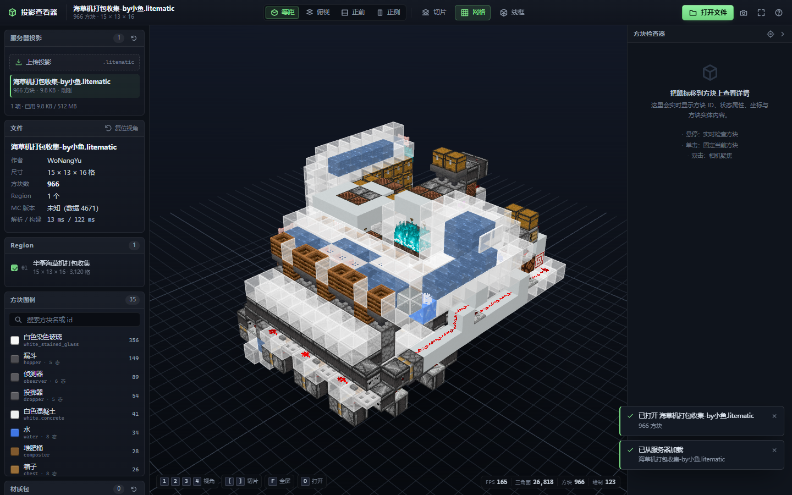
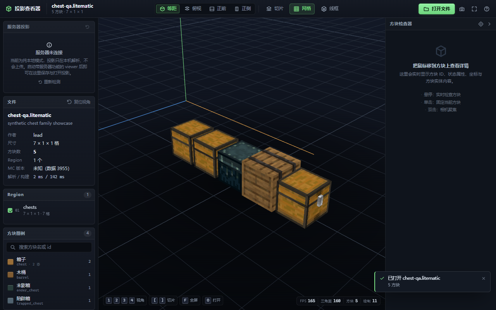
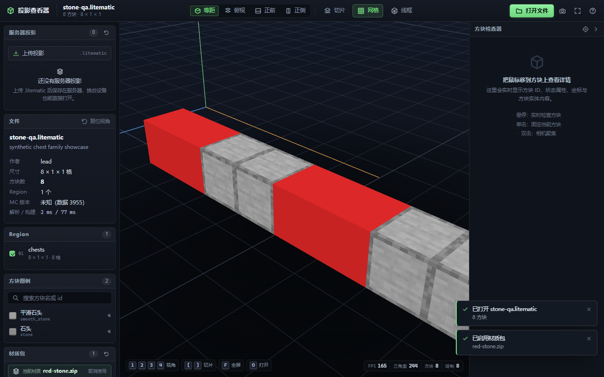
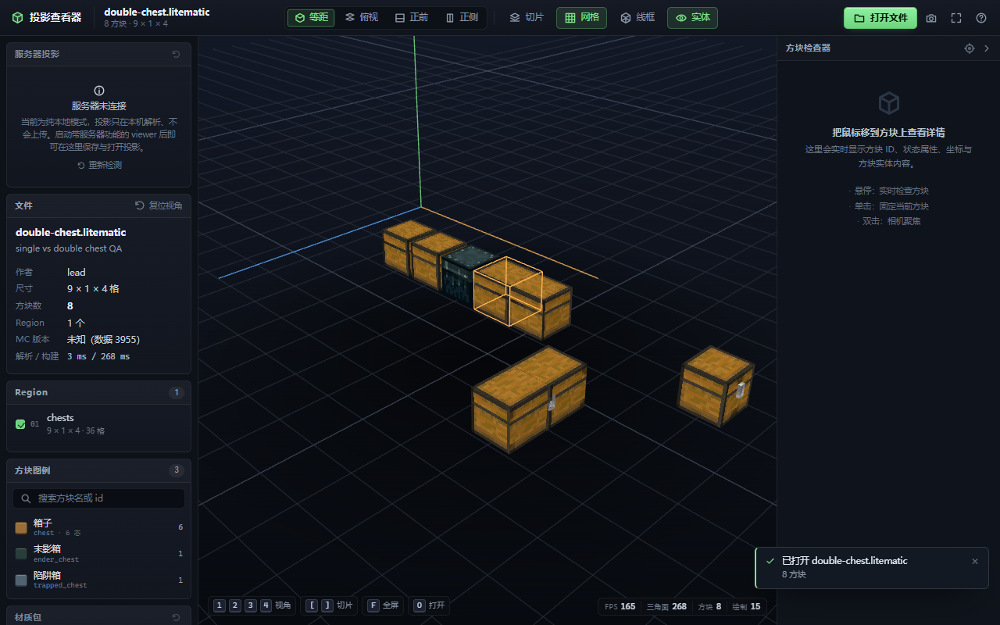
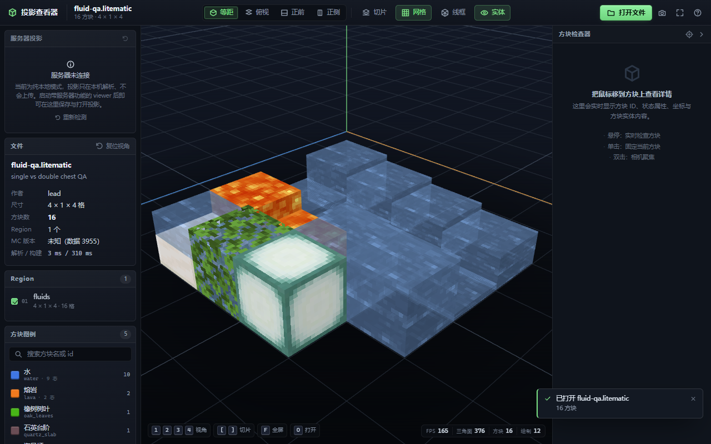
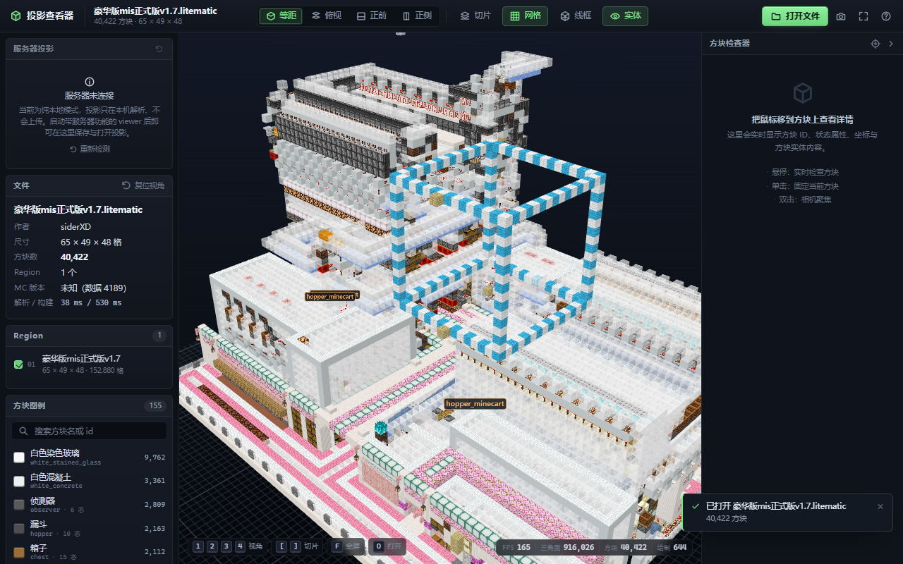
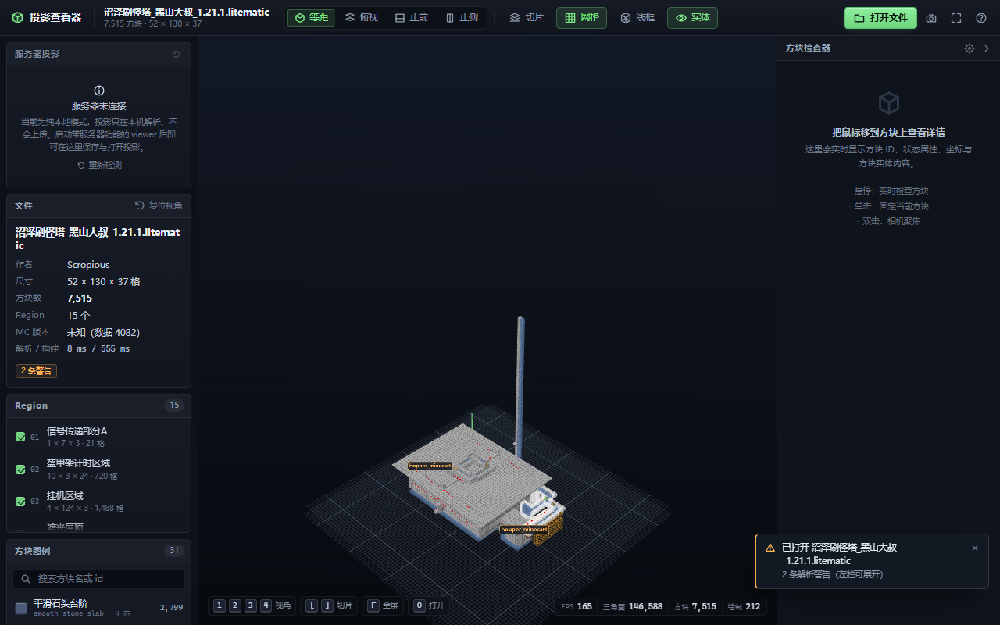
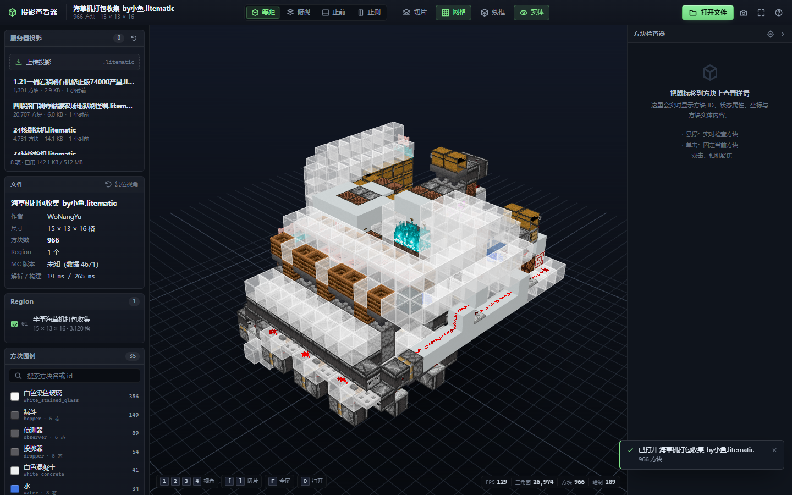

# mcviewer · 投影查看器

**不用启动 Minecraft，就能在浏览器里 3D 查看 `.litematic` 投影文件。**

Litematica（中文玩家常说的"投影""投影仪"）是 Minecraft 上最常用的原理图模组，作者 masa。
它的存档文件 `.litematic` 是一个 gzip 压缩的 NBT 结构，平时只能在游戏里加载查看——要开客户端、进世界、
对准投影、飞来飞去。**mcviewer 把这些全部省掉**：双击一个 bat，浏览器打开，把文件拖进去，就能像看 3D 模型一样
旋转、缩放、逐层切开、点开每个方块看它的属性和箱子里的东西。

纯本地、纯静态：解析在你的浏览器里完成，**文件不会上传到任何地方**，也不需要联网。

---

## 快速开始

### 方式一：双击（推荐）

双击 **`启动查看器.bat`**。

- 首次运行会自动安装依赖（需要 Node.js 20+，只需一次）
- 然后会自动构建、启动本地服务并打开浏览器
- 关闭那个黑色命令行窗口 = 退出查看器

### 方式二：命令行

```bat
pnpm install          :: 或 npm install
node build.mjs        :: 构建到 dist/
node server.mjs --open    :: 启动 http://127.0.0.1:5178/ 并打开浏览器
```

> 必须通过 `http://` 访问。直接双击 `dist/index.html`（`file://`）会因为浏览器的跨域限制而无法读取资产与示例文件。

## 能做什么

- **打开 / 拖放** `.litematic`（兼容 Litematica Version 7，已用 5 个真实投影验证，含 15 个 region、40 万个方块的超大工程）
- **真 3D 自由观察**：轨道旋转、平移、**线性缩放**（每格滚轮固定移动一段距离，不随远近变化）、视角预设（等距 / 俯视 / 前 / 侧）、一键框住模型
- **逐层切片**：拖动滑块或按 `[` `]` 一层层剥开建筑内部（按实例整层截断，切口干净，不会出现背面重影）
- **Region 显隐**：多 region 投影可以单独看某一层结构
- **方块图例**：按数量排序，中文名 + 英文 id，搜索、点击高亮定位
- **点选方块**：坐标、完整方块状态（朝向/半砖/水位…）、**方块实体内容**（箱子/发射器里的物品、告示牌文字、比较器输出……）；选择框会贴合方块实际体积（台阶、栅栏、火把不再套整格框）
- **流体与含水**：水源/岩浆源按 `level` 渲染真实高度，流动水/岩浆、下落水柱、气泡柱都对；`waterlogged=true` 的台阶/楼梯/树叶会在方块里叠一层水
- **实体标记**：生物、载具会在原位置显示名字标签（`E` 键开关；物品展示框/画/盔甲架这类成排装饰默认不标）
- **双箱子**：`type=left/right` 的两个半块会严丝合缝拼成一个 30px 宽的大箱子（陷阱箱同理）
- **统计信息**：尺寸、体积、非空方块数、方块实体数、实体数、数据版本、解析警告
- **截图**：一键导出当前视角 PNG
- **服务器投影库**（可选，部署后启用）：把 `.litematic` 上传到服务器持久保存，换台电脑直接打开，侧栏一点即载
- **材质包**（可选，部署后启用）：上传 zip 资源包，服务器烘焙成 viewer 资产，一键切换方块外观（例如把石头换成别的材质）
- 深色界面、全键盘操作、无任何外部 CDN 依赖（离线可用）



<table>
<tr>
<td></td>
<td></td>
</tr>
<tr>
<td align="center">箱子/末影箱/木桶按原版实体模型渲染（修复前是整块木板）</td>
<td align="center">上传材质包 → 服务器烘焙 → 侧栏一键启用（石头已换成红色）</td>
</tr>
</table>

### 最近更新（2026-10-26）

<table>
<tr>
<td></td>
<td></td>
</tr>
<tr>
<td align="center">双箱子拼成 30px 宽、中间只有一个锁扣</td>
<td align="center">水流按 <code>level</code> 分级高度、岩浆同理、含水方块叠水层</td>
</tr>
<tr>
<td></td>
<td></td>
</tr>
<tr>
<td align="center">玻璃改为写深度，能正确看到里面（不再整片发白）</td>
<td align="center">切片按层截断实例，切口干净、无背面重影</td>
</tr>
</table>


## 它是怎么做到的

两个完全独立的数据管线，只通过 `docs/CONTRACT.md` 里的接口耦合：

```
client-1.21.x.jar ──[tools/bake/*.py]──► assets/{blocks,models,atlas,lang}.json+png   一次性烘焙，离线
      .litematic  ──[src/core/*.js]───► Schematic 对象（纯浏览器解析）
Schematic + assets ──[src/render/*]────► three.js InstancedMesh 场景 ──► 你的屏幕
```

- **烘焙**：从官方客户端 jar 里抽出所有方块模型的几何、纹理、方块状态定义、中英文名，
  按原版规则展开 `blockstates` 的 `variants/multipart`、`model` 的 parent 链与 `#变量`、`elements` 的
  `rotation/uv/uvlock`，打包成一张图集 + 几个 JSON。这步只在开发时跑，产物直接进仓库。
- **解析**：浏览器里 gunzip → 读 NBT → 解连续位打包的 `BlockStates` → 得到每个 region 的方块状态索引，
  再按 chunk 分组成 `InstancedMesh`。
- **渲染**：按方块状态分实例化网格，把原版的"面明暗"（顶 1.0 / 侧 0.8 / 底 0.5）和生物群系着色烘进顶点色，
  用 `MeshBasicMaterial + atlas` 画出完全等同于游戏内的观感；水/冰等半透明走独立 pass。

文件格式细节（负 Size、连续位打包、两种方块实体写法、实体坐标系……）见 **[docs/FORMAT.md](docs/FORMAT.md)**。

## 目录

```
mcviewer/
├─ 启动查看器.bat        最终用户入口
├─ index.html            页面骨架
├─ styles.css            界面样式
├─ build.mjs             esbuild 打包 + 复制资产
├─ server.mjs            静态服务器 + 可选上传/材质包 API
├─ src/
│  ├─ core/              .litematic 解析器（纯 ESM，无依赖）
│  ├─ render/            BlockDB、几何构建、three 场景、拾取
│  ├─ ui/                面板/工具栏/图例/检查器/投影库/材质包
│  ├─ server/            服务端 API（存储、限速、令牌、ZIP 校验、材质包烘焙队列）
│  └─ app.js             入口：串联解析 → 渲染 → UI
├─ tools/
│  ├─ bake/              客户端 jar → assets/ 的烘焙脚本（含 pack.py 材质包烘焙、post_entity_models.py 箱子实体模型）
│  ├─ qa/                烘焙产物目视 QA（箱子展示投影 + 截图脚本）
│  ├─ lead_qa/           合成小投影（箱子/石头），用于独立验收
│  ├─ truth.py           独立 Python oracle（校验解析器）
│  └─ nbtref.py          极简 NBT 读写参考实现
├─ assets/               烘焙产物（图集 + JSON）
├─ data/                 运行时数据（服务器投影 / 材质包），不入库
├─ tests/
│  ├─ fixtures/          5 个真实 .litematic 测试样本
│  ├─ parser/            解析器自检 + expected.json
│  ├─ api/               服务端 API 自检（50 项，无浏览器）
│  ├─ ui/                侧栏/材质包端到端冒烟（真实上传 + Chrome 截图）
│  ├─ packs/             材质包测试样本
│  └─ e2e/               端到端（Chrome 截图 + 统计断言）
├─ deploy/               线上部署脚本（server-setup.sh / enable-ssl.sh / server-verify.sh）
└─ docs/
   ├─ CONTRACT.md        三方接口契约
   ├─ API.md             服务端 API 与前端面板契约
   ├─ SECURITY.md        部署安全审查报告
   ├─ DEPLOY.md          线上部署与运维手册（ser8-home / 宝塔）
   ├─ FORMAT.md          .litematic 格式实测备忘
   └─ shots/             文档用截图
```

## 部署到服务器（可选）

不启动服务器时就是纯本地工具（文件只在浏览器里解析，不上传）。启动带 `--data` 的服务后，
多了一组**上传投影 / 上传材质包**的能力，投影会持久化到 `data/projects/`，材质包会烘焙到 `data/packs/`。

```bat
:: 本机自用：监听 127.0.0.1，无令牌
node server.mjs --open

:: 部署：绑定内网地址 + 访问令牌 + 自定义数据目录 + 上传上限 64 MB
node server.mjs --host 0.0.0.0 --port 5178 --token "换成一串 32 位随机字符" --data D:\mcviewer-data --max-upload-mb 64
```

- **必须设 `--token`**（或环境变量 `MCVIEWER_TOKEN`）再对外提供，否则任何能访问端口的人都能上传/删除。
- 对外请放在 **HTTPS 反向代理**之后（CSP 与安全头已内置，但明文传输会把令牌暴露给链路上任何人）。
- 材质包需要服务器有 Python 3 + 官方客户端 jar 才能烘焙；缺环境时接口返回 503，界面会显示原因，其余功能不受影响。
- 配置项、威胁模型、nginx 反代与令牌说明见 **[docs/SECURITY.md](docs/SECURITY.md)**；
  接口字段与前端面板契约见 **[docs/API.md](docs/API.md)**。

### 线上实例

- 页面：<http://litematic.zuoqirun.top>
- 部署形态：宝塔「Node 项目」`litematic_viewer`（`/usr/bin` 无依赖，用宝塔自带的 Node v24）监听 `127.0.0.1:5180`，静态文件与 `/api`、`/packs` 全部由它提供，nginx 只做 80/443 入口反代；开机自启由宝塔 `is_power_on` 负责
- 访问策略：**不设令牌，任何人可浏览/上传/删除**（写接口按 IP 限速 20 次/分钟；想收紧就按 DEPLOY.md 加回 `MCVIEWER_TOKEN`）
- 首屏做了五层优化（按需模型分片、brotli 预压缩、`?v=` + immutable 缓存、图集无损 WebP、分段加载）：空态首屏 ≈ 170 KB（HTTPS）/ 198 KB（HTTP），打开一个投影**只下它实际用到的方块模型**、再下 ≈ 370 KB，二次访问 ≈ 6 KB；细节与实测表见 **[docs/DEPLOY.md](docs/DEPLOY.md)**「首屏体积与缓存」
- 完整运维手册（目录、令牌、升级、备份、排错）：**[docs/DEPLOY.md](docs/DEPLOY.md)**



## 测试

```bat
node tests/parser/run.mjs         :: 解析器 vs 独立 Python oracle（逐文件比对方块数/region/包围盒）
node tests/api/run.mjs            :: 服务端 API（鉴权/上传/下载/限速/路径穿越/ZIP 校验/持久化）
node tests/ui/panels-shot.mjs     :: 侧栏两卡离线 harness（8 状态：正常/上传 45%/错误/空/离线/令牌/悬停/XSS）
node tests/ui/server-smoke.mjs    :: 侧栏投影库 + 材质包面板 + 从服务器加载（Chrome 截图）
node tests/ui/pack-smoke.mjs      :: 材质包端到端：上传 zip → 服务端烘焙 → 侧栏启用 → 画面真的变色
node tests/ui/deployed-smoke.mjs  :: 线上实例冒烟（把域名解析到内网 IP，走真实 nginx 打开页面并加载样例）
node tests/e2e/run.mjs            :: 构建 → 起服务 → Chrome 逐个打开 fixture → 断言统计 + 截图
pnpm test                         :: parser + api + e2e
```

`server-smoke` / `pack-smoke` 需要服务器端具备 Python 3 与 `_dl/client-1.21.1.jar`（与材质包烘焙同样的依赖），因此没有并入默认 `pnpm test`；
`panels-shot` 是纯离线的 UI harness（stub 掉后端，不需要 Python）；`deployed-smoke` 只用于检查线上部署。

e2e 会把每个 fixture 的渲染结果截图到 `tests/e2e/_shots/`，并检查控制台零报错、切片与显隐真的生效。

## 已知限制

- 只支持 Litematica `.litematic`（Version 7）；WorldEdit `.schem`、Sponge `.schematic`、原版结构文件不支持。
- 不做版本迁移：文件里出现的方块状态名直接拿去资产库查，1.21.1 之外新增方块会显示为洋红色"缺失"块
  （数量会统计在 UI 告警里）。资产同时抽了 26.3 的补缺，覆盖率已尽量拉满。
- **生物群系着色用默认色**：草、树叶、水一律用主世界默认色，不区分群系；红石线固定按最高亮度红色显示。
- 实体只有名字标签（生物/载具），没有办法还原原版实体模型（原版把生物模型放在 Java 代码里，资源包里没有几何）；
  物品展示框/画/盔甲架这类成排装饰默认不标，`E` 键只控制这个标签层。
- 计划刻（PendingBlockTicks）只展示，不模拟。
- 少量几何瑕疵：`pale_oak_hanging_sign`（苍白橡木悬挂牌）有 32 个 quad 的朝上面位与其几何平面正交，
  明暗与背面剔除可能略偏，肉眼几乎不可见；`end_gateway` / `end_portal` 原版本就没有几何，显示为空。
- 水的贴图用的是原版 `water_still` 占位、颜色按主世界默认色着色，所以水面没有原版的流动感与波浪；
  岩浆同理（用的是静态岩浆纹理）。
- 双箱子依赖材质包里 `normal_left/right` 两张半块贴图；材质包如果只替换了 `normal.png`，双箱子的接缝面仍用内置贴图。
- 纹理采样使用最近邻且不生成 mipmap（保持像素风），远距离观看高频纹理（如白染色玻璃）会有轻微闪动，
  拉近观看即可消除。
- 超大投影（>50 万方块）在集成显卡上可能掉帧；可先关掉部分 region 或切片。
- **材质包只影响方块外观**：覆盖 `blockstates/`、`models/`、`textures/block/` 与语言文件；不处理自定义字体、
  GUI、着色器、粒子，也不处理实体纹理（箱子三类除外，走服务端烘焙）。动画纹理仍只取首帧。
  上传的 zip 需 ≤5000 个条目、解压后 ≤256 MB，且必须包含 `assets/minecraft` 结构。
  材质包若引入了内置资源里不存在的方块（模组方块等），会作为新方块生效；没有贴图的方块显示为缺失占位。
- 服务器投影库没有账号体系，只有「可选访问令牌」这一层；多人共用时令牌即全权，请配合反代与内网访问控制。

## 致谢 / 声明

- 文件格式与坐标系语义参考 [Litematica](https://github.com/maruohon/litematica)（作者 masa）源码。
- 方块纹理、模型、名称等素材版权归 **Mojang Studios / Microsoft** 所有，本项目仅在本地个人使用场景下
  从用户自备的官方客户端 jar 烘焙，不随项目分发任何 Minecraft 素材。
- 本项目与 Mojang、Litematica 作者均无关联。
